# ลุยงาน! (Todo Frontend)

| ส่วน | ลิงก์ |
|---|---|
| Frontend (Vue 3) | https://github.com/Felsau/todo-frontend |
| API (AdonisJS 5) | https://github.com/Felsau/todo-api |
| เว็บจริงสำหรับลองใช้ | https://todo-frontend-xuka.onrender.com |

"ลุยงาน!" คือแอปจดงานที่ต้องทำ เปิดผ่านเว็บได้ทั้งบนคอมและมือถือ จดงาน ใส่วันกำหนดส่ง ติ๊กว่าเสร็จ และลบงานได้ ทุกอย่างที่ทำจะถูกบันทึกลงฐานข้อมูลทันที ปิดเว็บหรือกดรีเฟรชแล้วงานก็ยังอยู่ครบ

repo นี้คือส่วนหน้าเว็บที่คนใช้เห็นและกด ส่วนที่รับคำสั่งแล้วเก็บข้อมูลอยู่อีก repo หนึ่งคือ [todo-api](https://github.com/Felsau/todo-api)

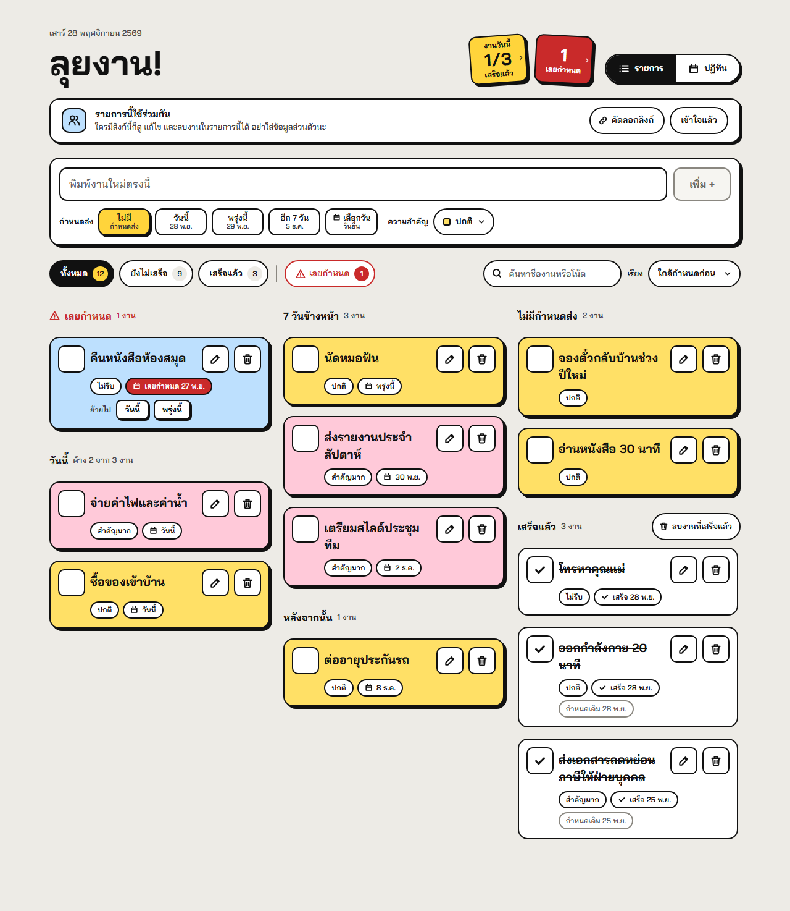

## ลองใช้งาน

เปิด https://todo-frontend-xuka.onrender.com ได้เลย ไม่ต้องสมัครสมาชิก ในเว็บมีงานตัวอย่างไว้ให้ลองกด 12 งาน

มีสองเรื่องที่ควรรู้ก่อนลองครับ

**ครั้งแรกอาจต้องรอราว 30 ถึง 40 วินาที** เซิร์ฟเวอร์ที่เก็บข้อมูลใช้แพ็กเกจฟรี ถ้าไม่มีใครเปิดเว็บนาน 15 นาที มันจะหลับไป คนแรกที่เปิดหลังจากนั้นต้องรอให้มันตื่น ระหว่างนั้นหน้าเว็บจะขึ้นการ์ดบอกว่ากำลังเปิดรายการพร้อมนับวินาที ไม่ต้องกดรีเฟรช พอเซิร์ฟเวอร์ตื่นแล้วงานจะขึ้นมาเอง

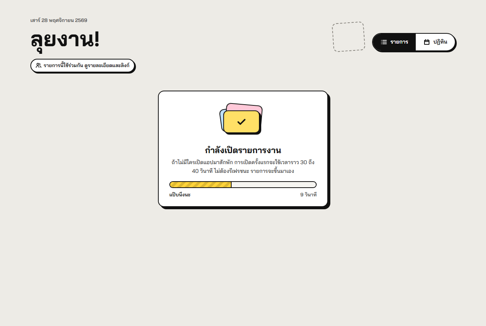

**รายการนี้ใช้ร่วมกันทุกคน** แอปนี้ไม่มีระบบเข้าสู่ระบบ ตามโจทย์มีรายการงานชุดเดียว ใครเปิดลิงก์ก็เห็น แก้ และลบงานชุดเดียวกัน หน้าเว็บจึงมีกล่องเตือนว่าอย่าพิมพ์ข้อมูลส่วนตัว ถ้าลบงานจนหมด ระบบจะใส่งานตัวอย่าง 12 งานกลับมาให้เอง

## ทำอะไรได้บ้าง

### เพิ่มงาน

บนคอม พิมพ์ชื่องานในช่องด้านบนแล้วกด เพิ่ม บนมือถือ กดปุ่มกลม + ที่มุมล่างขวา แล้วจะมีแผ่นเพิ่มงานเลื่อนขึ้นมา

วันกำหนดส่งเลือกได้ในครั้งเดียว มีปุ่ม ไม่มีกำหนดส่ง วันนี้ พรุ่งนี้ และอีก 7 วัน ใต้แต่ละปุ่มเขียนวันที่จริงไว้ให้ ถ้าต้องการวันอื่นกด เลือกวัน แล้วจะมีปฏิทินภาษาไทยที่แสดงปี พ.ศ. ขึ้นมา หน้าตาเหมือนกันทุกเครื่อง ไม่ว่าจะเปิดจากมือถือหรือคอมยี่ห้อไหน ความสำคัญเลือกได้สามระดับ คือ สำคัญมาก ปกติ และไม่รีบ การ์ดแต่ละระดับมีสีต่างกัน

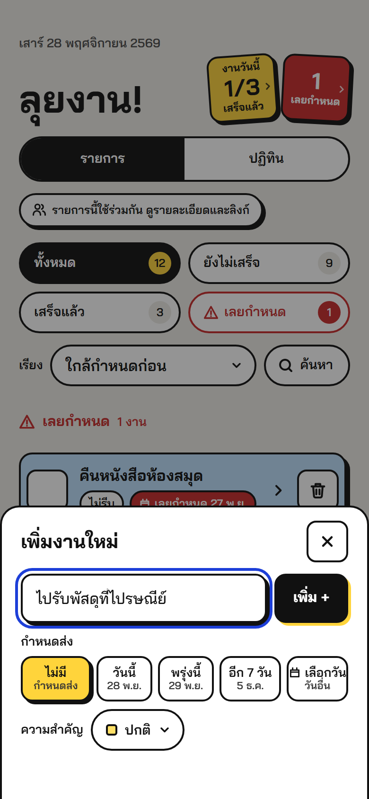

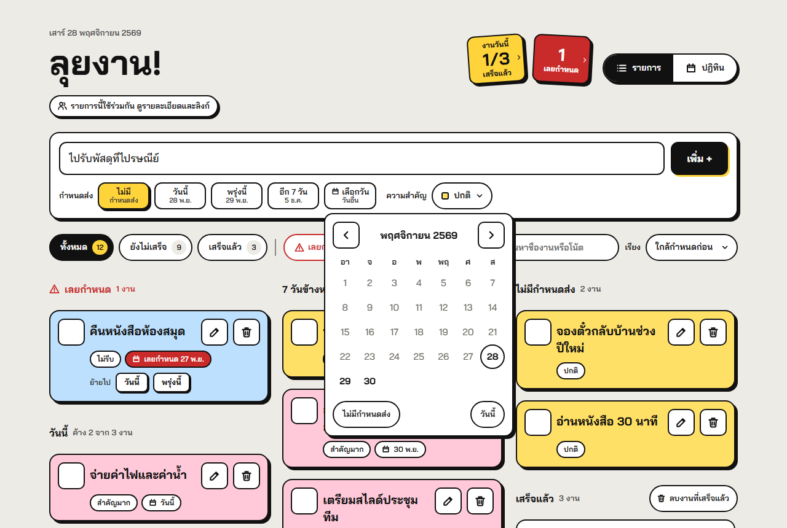

### ติ๊กว่าเสร็จ

กดช่องสี่เหลี่ยมหน้างาน งานจะขีดฆ่าและย้ายไปอยู่กลุ่ม เสร็จแล้ว พร้อมบอกวันที่ทำเสร็จ ถ้ากดพลาด กด เลิกทำ ในแถบด้านล่างได้

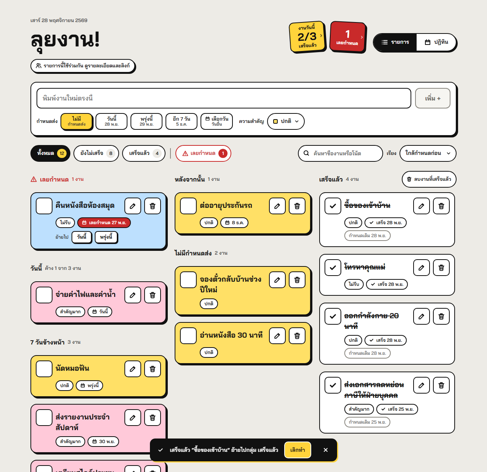

### ลบงาน

กดปุ่มถังขยะ งานจะหายไปทันที และมีแถบ เลิกทำ ให้กดเอากลับมาได้ภายใน 8 วินาที งานที่กู้กลับมาจะเหมือนเดิมทุกอย่าง ทั้งชื่อ โน้ต และวันกำหนดส่ง ถ้าอยากล้างงานที่ทำเสร็จแล้วทั้งหมด มีปุ่ม ลบงานที่เสร็จแล้ว ที่หัวข้อกลุ่ม เสร็จแล้ว

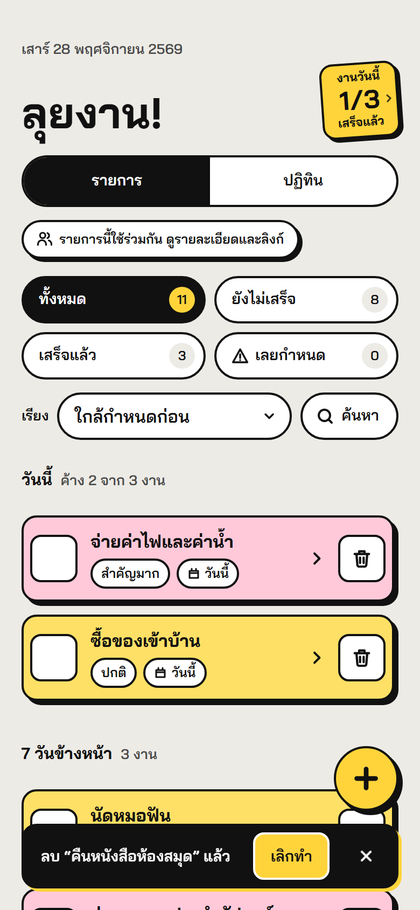

### ดูและแก้รายละเอียด

กดที่ชื่องานเพื่อเปิดหน้ารายละเอียด แก้ชื่อ สถานะ วันกำหนดส่ง ความสำคัญ และโน้ตได้ ถ้าแก้แล้วกดปิดโดยยังไม่บันทึก แอปจะถามก่อนว่าจะทิ้งที่แก้ไว้ไหม

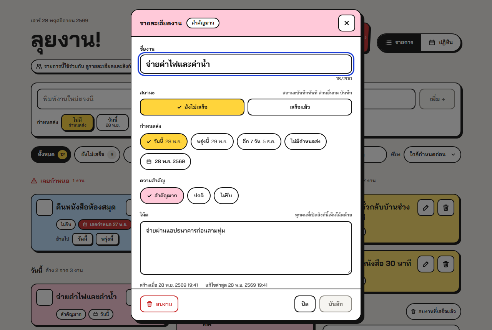

### หางานได้เร็ว

ป้ายเหลืองมุมขวาบนบอกว่างานที่ต้องส่งวันนี้เสร็จไปกี่งานแล้ว เช่น 1/3 คือเสร็จ 1 จาก 3 งาน ป้ายแดงบอกว่ามีงานที่เลยกำหนดแล้วกี่งาน กดป้ายแล้วจะพาไปที่งานกลุ่มนั้น

งานจัดเป็นกลุ่มให้อัตโนมัติ ได้แก่ เลยกำหนด วันนี้ 7 วันข้างหน้า หลังจากนั้น ไม่มีกำหนดส่ง และเสร็จแล้ว ด้านบนมีปุ่มกรอง ทั้งหมด ยังไม่เสร็จ เสร็จแล้ว และเลยกำหนด มีช่องค้นหาที่หาได้ทั้งจากชื่องานและโน้ต และเลือกเรียงตามวันกำหนดส่ง ความสำคัญ หรืองานที่เพิ่มล่าสุดได้ งานที่เลยกำหนดมีปุ่ม ย้ายไปวันนี้ หรือพรุ่งนี้ ให้กดครั้งเดียว

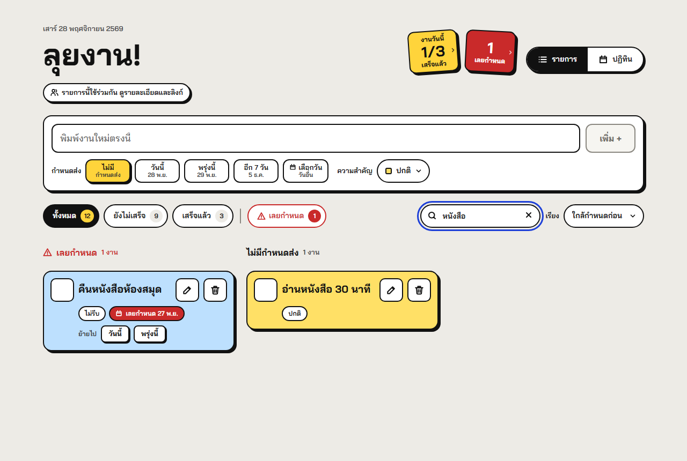

### ปฏิทิน

กด ปฏิทิน ด้านบนเพื่อดูงานตามวัน บนคอมเป็นปฏิทินทั้งเดือน บนมือถือเป็นแถบทีละสัปดาห์ กดวันไหนก็เห็นงานของวันนั้น และเพิ่มงานลงวันนั้นได้เลย สีของแต่ละงานบอกความสำคัญ สีแดงคือเลยกำหนด

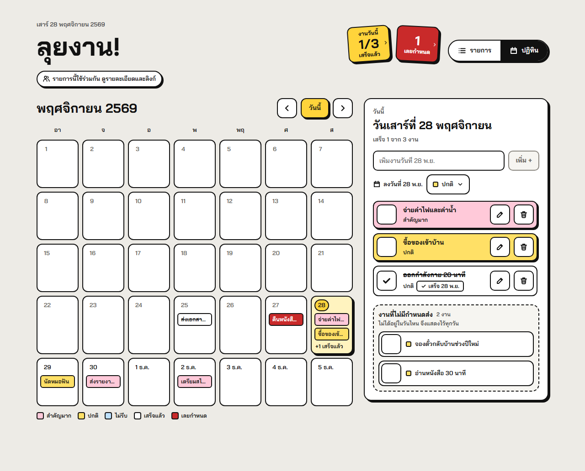

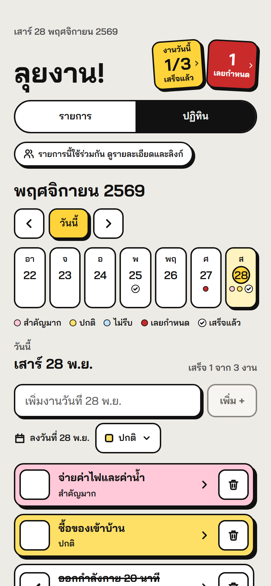

### ใช้ได้ทั้งคอมและมือถือ

หน้าจอปรับตามขนาดเครื่อง บนคอมงานเรียงเป็นสามคอลัมน์ บนมือถือเรียงคอลัมน์เดียว ปุ่มทุกปุ่มใหญ่พอให้นิ้วกดได้สบาย และช่องพิมพ์ไม่ทำให้ iPhone ซูมหน้าเองตอนแตะ

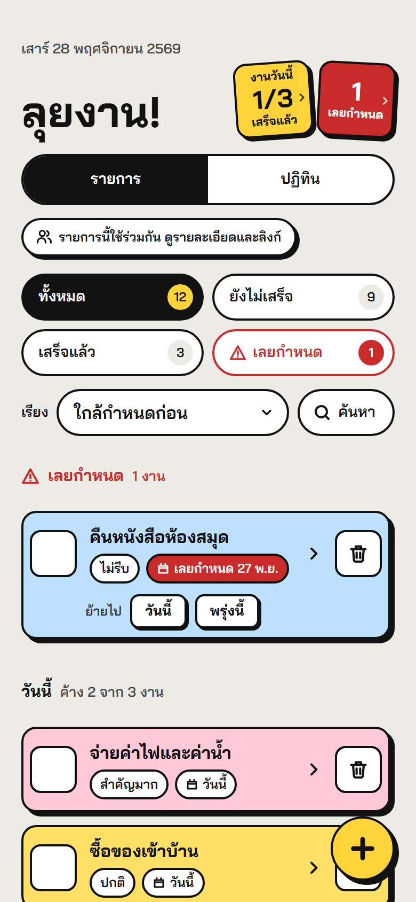

### ถ้าเน็ตหลุดหรือบันทึกไม่สำเร็จ

หน้าจอจะเปลี่ยนให้เห็นทันทีที่กด ไม่ต้องรอ ถ้าส่งไปบันทึกไม่สำเร็จ งานจะกลับเป็นแบบเดิมและมีแถบสีแดงบอก ถ้าเพิ่มงานไม่สำเร็จ ข้อความที่พิมพ์ไว้จะกลับมาอยู่ในช่องเดิม ไม่ต้องพิมพ์ใหม่ ถ้าเครื่องหลุดจากอินเทอร์เน็ตจะมีแถบแจ้ง และพอต่อเน็ตได้ รายการจะโหลดใหม่ให้เอง

## ตรงกับโจทย์ข้อไหน

| โจทย์ | ในแอปนี้ |
|---|---|
| ใช้ HTML, CSS, TypeScript และ Frontend Framework | Vue.js 3 เขียนด้วย TypeScript |
| เพิ่มรายการ todo ได้ | ช่องเพิ่มงานบนคอม และปุ่ม + บนมือถือ |
| ลบรายการ todo ได้ | ปุ่มถังขยะ มีเลิกทำ |
| ทำเครื่องหมายว่าเสร็จได้ | ช่องติ๊กหน้างาน |
| ใช้ CSS ให้สวยและใช้ง่าย | Tailwind CSS |
| Responsive บนมือถือและเว็บ | ตามภาพหน้าจอด้านบน |
| ทุกการกระทำส่งไปที่ API | เพิ่ม ติ๊ก แก้ และลบ ส่งไปที่ todo-api ทุกครั้ง |
| รีเฟรชแล้วรายการยังอยู่ | ทุกครั้งที่เปิดหน้า แอปดึงรายการจาก API |

## สำหรับนักพัฒนา

### เครื่องมือที่ใช้

Vue.js 3 เขียนด้วย TypeScript, Vite สำหรับรันและ build, Tailwind CSS v4 สำหรับหน้าตา, vue-router สำหรับสองหน้า คือ รายการ (`/`) และปฏิทิน (`/calendar`) ฟอนต์คือ Bai Jamjuree ที่รวมไว้ในเว็บเอง ทุกปุ่มและหน้าต่างเขียนเอง ไม่ได้ใช้ชุด UI สำเร็จรูป

### รันในเครื่อง

ต้องเปิด todo-api ก่อน (ดูวิธีใน README ของ [todo-api](https://github.com/Felsau/todo-api)) แล้วจึงรันหน้าเว็บ

```bash
npm install
cp .env.example .env   # บอกหน้าเว็บว่า API อยู่ที่ไหน
npm run dev            # เปิดที่ http://localhost:5173
```

ในไฟล์ `.env` มีค่าเดียวคือ `VITE_API_URL` ซึ่งเป็นที่อยู่ของ API ค่าเริ่มต้นคือ `http://localhost:3333`

สร้างไฟล์สำหรับขึ้นเว็บจริงด้วย `npm run build` คำสั่งนี้ตรวจ TypeScript ก่อน แล้วค่อยสร้างไฟล์ไว้ในโฟลเดอร์ `dist`

### ขึ้นเว็บจริง

หน้าเว็บอยู่บน Render แบบ Static Site คำสั่ง build คือ `npm ci && npm run build` ตั้ง `VITE_API_URL=https://todo-api-g7v9.onrender.com` ไว้ตอน build และตั้งให้ทุกที่อยู่ส่ง `index.html` กลับไป เพื่อให้เปิดหรือรีเฟรชหน้า `/calendar` ได้โดยตรง เว็บจริงยังมีส่วนหัวความปลอดภัย ที่บังคับให้หน้าเว็บโหลดไฟล์จากตัวเองและคุยกับ API ของเราเท่านั้น

ส่งลิงก์ใน LINE, Facebook หรือ Discord แล้วจะขึ้นชื่อแอปพร้อมรูปตัวอย่าง รูปนี้และไอคอนสร้างจากไฟล์ในโฟลเดอร์ `brand` เว็บตั้งใจไม่ให้ Google เก็บ เพราะใครก็พิมพ์งานลงในรายการนี้ได้ ถ้าถูกค้นเจอ ข้อความที่คนอื่นพิมพ์ไว้อาจไปโผล่ในผลค้นหา

### โครงสร้างไฟล์

```
src/
  App.vue                 โครงหน้า ส่วนหัว และแถบแจ้งเตือน
  views/                  หน้ารายการ และหน้าปฏิทิน
  components/             การ์ดงาน ช่องเพิ่มงาน ปฏิทินเลือกวัน หน้ารายละเอียด และอื่น ๆ
  composables/useTodos.ts ข้อมูลงานทั้งหมด การส่งไป API การย้อนกลับเมื่อพลาด และการเลิกทำ
  api/todos.ts            คำสั่งเรียก API ทุกตัว
  utils/date.ts           วันที่ภาษาไทยและปี พ.ศ.
brand/                    ต้นฉบับรูปแชร์ลิงก์และไอคอน
public/                   ไอคอน รูปแชร์ลิงก์ และ robots.txt
docs/screenshots/         ภาพหน้าจอในไฟล์นี้
```

### การทดสอบ

เราตรวจแอปสี่รอบ โดยลองใช้แบบคนจริงหลายแบบ เช่น คนที่เปิดครั้งแรก คนที่ใช้มือถือจอเล็ก และคนที่ต้องหางานเร็ว ๆ ทุกปัญหาที่เจอได้รับการแก้ แล้วเขียนสคริปต์ Playwright ไว้ตรวจซ้ำอัตโนมัติ รวมทั้งหมด 613 ข้อ ผ่านทุกข้อ ส่วนการทดสอบ API ด้วย Postman (32 คำขอ 71 ข้อตรวจ) อยู่ใน README ของ todo-api

คะแนน Lighthouse บนเว็บจริง: ความเร็ว 99 ถึง 100 การเข้าถึง 100 แนวปฏิบัติที่ดี 100

ภาพหน้าจอในไฟล์นี้ถ่ายจากแอปเวอร์ชันปัจจุบันด้วยสคริปต์ `tools/shot/readme.mjs` ของโปรเจกต์หลัก โดยใช้งานตัวอย่างชุดเดียวกับเว็บจริง
