# Todo Frontend

หน้าเว็บของแอป Todo List ชื่อ "ลุยงาน!" ทำด้วย Vue.js 3 และ TypeScript ดีไซน์แบบ neo-brutalist ทุกการกระทำส่งคำขอไปที่ [todo-api](../todo-api) ทันที และรีเฟรชหน้าแล้วรายการยังอยู่ เพราะดึงจาก API ทุกครั้งที่เปิดหน้า

ลองใช้งานได้ที่ https://todo-frontend-xuka.onrender.com APIใช้แพ็กเกจฟรีของ Render ซึ่งจะหลับเมื่อไม่มีคนใช้ 15 นาที การเปิดครั้งแรกหลังจากนั้นจึงอาจช้าราว 1 นาที

## ฟีเจอร์

มุมมองรายการให้เพิ่มงานจากช่องพิมพ์ด้านบน เลือกกำหนดส่งและความสำคัญจากชิปสรุปสองอัน ติ๊กว่าเสร็จ แก้ไข ลบ และเลิกทำการลบภายใน 5 วินาที ลบหลายงานติดกันก็เลิกทำได้ทั้งหมดในครั้งเดียว เพิ่มงานแล้วมีแถบยืนยัน ถ้างานใหม่อยู่นอกจอจะมีปุ่ม "ดูงาน" พาไปที่การ์ด มีตัวกรอง ทั้งหมด ยังไม่เสร็จ เสร็จแล้ว เลยกำหนด พร้อมจำนวน ค้นหาจากชื่อ เรียงตามกำหนดส่ง ความสำคัญ หรือเพิ่มล่าสุด และงานที่เสร็จแล้วจะอยู่ท้ายรายการเสมอ ปุ่มลบงานที่เสร็จแล้วมีขั้นตอนยืนยันในบรรทัดเดียวกันและเลิกทำได้ ปุ่มย้อนกลับของมือถือปิดหน้ารายละเอียดและแผงตัวเลือกแทนการออกจากแอป ถ้ามีงานที่แก้ค้างไว้จะถามก่อน

หน้ารายละเอียดเปิดเป็นป๊อปอัปบนจอใหญ่และแผงเลื่อนขึ้นบนมือถือ แก้ได้ทั้งชื่อ สถานะ กำหนดส่ง ความสำคัญ และโน้ต ถ้ากดปิดตอนที่ยังไม่บันทึกจะถามว่าทิ้งการแก้ไขไหม การบันทึกส่งเฉพาะฟิลด์ที่เปลี่ยน ถ้าบันทึกไม่สำเร็จหน้าต่างจะไม่ปิดและค่าที่แก้ยังอยู่ครบ

มุมมองปฏิทินเป็นรายเดือนบนจอใหญ่ และเป็นแถบสัปดาห์บนมือถือ เลือกวันแล้วดูงานของวันนั้นและเพิ่มงานลงวันนั้นได้ทันที

ทุกการกระทำอัปเดตหน้าจอก่อน (optimistic) แล้วย้อนกลับพร้อมแถบแจ้งเตือนสีแดงถ้าส่งไม่สำเร็จ ไอคอนหมุนจะขึ้นในปุ่มติ๊กเมื่อรอเกิน 300 มิลลิวินาที ตอนโหลดมี skeleton ถ้ารอเกิน 3 วินาทีจะเปลี่ยนเป็นการ์ด "กำลังเตรียมรายการงานของคุณ" ที่บอกด้วยภาษาธรรมดาว่าอาจรอราว 1 นาที พร้อมการ์ดสามใบที่ขยับเบาๆ แถบความคืบหน้า และจำนวนวินาทีที่รอ และจะลองเรียกใหม่เองจนเซิร์ฟเวอร์ตื่น (สูงสุด 2 นาที) เพราะ API อยู่บนแพ็กเกจฟรีที่หลับเมื่อไม่มีคนใช้ ถ้าโหลดไม่ได้จริงจะมีการ์ดพร้อมปุ่มลองใหม่ ถ้าเครื่องไม่ได้ต่ออินเทอร์เน็ตจะบอกทันทีและโหลดเองเมื่อต่อได้ เพิ่มงานไม่สำเร็จข้อความที่พิมพ์ไว้จะกลับมาอยู่ในช่องเดิม และเมื่อกลับมาที่แท็บนี้ รายการจะดึงใหม่เพื่อให้เห็นสิ่งที่แก้จากแท็บหรือเครื่องอื่น วันที่แสดงเป็นปีพุทธศักราชด้วย `Intl.DateTimeFormat('th-TH')` ส่วนการใช้งานด้วยคีย์บอร์ดรองรับทั้งหน้ารายการ ตัวเลือก หน้ารายละเอียด และปฏิทิน ปุ่มและจุดกดทุกจุดมีขนาดอย่างน้อย 44 พิกเซล ช่องพิมพ์บนมือถือใช้ตัวอักษร 16 พิกเซลขึ้นไป เพื่อไม่ให้ iPhone ซูมหน้าเองตอนแตะ โปรแกรมอ่านหน้าจอได้ยินทุกข้อความแจ้งเตือน หลังลบหรือเลิกทำ ตำแหน่งคีย์บอร์ดจะไปอยู่ในที่ที่ใช้งานต่อได้ ไม่หลุดไปบนสุดของหน้า

## Tech Stack

Vue.js 3 แบบ Composition API (`<script setup lang="ts">`) กับ TypeScript โหมด strict, Vite, Tailwind CSS v4 ผ่าน `@tailwindcss/vite` โดยกำหนดโทเคนสี เงา และฟอนต์ไว้ใน `@theme`, vue-router สองเส้นทางคือ `/` และ `/calendar` และฟอนต์ Bai Jamjuree จาก Google Fonts ไม่ใช้ไลบรารี UI ทุกคอมโพเนนต์เขียนเอง

## การติดตั้งและรัน

ต้องเปิด todo-api ให้ทำงานก่อน (ดูวิธีในไฟล์ README ของ todo-api) แล้วจึงรันหน้าเว็บ

```bash
npm install
cp .env.example .env   # ตั้งค่า VITE_API_URL ให้ชี้ไปที่ API Server
npm run dev            # เปิดที่ http://localhost:5173
```

สร้างไฟล์สำหรับใช้งานจริงด้วย `npm run build` ซึ่งรัน `vue-tsc` ตรวจชนิดข้อมูลก่อนแล้วจึง build ด้วย Vite

## Environment Variables

`VITE_API_URL` คือ URL ของ RESTful API Server ค่าตัวอย่างคือ `http://localhost:3333` และ API อนุญาต CORS ให้ origin `http://localhost:5173`

## Deploy

หน้าเว็บอยู่บน Render แบบ Static Site คำสั่ง build คือ `npm ci && npm run build` โฟลเดอร์ที่เผยแพร่คือ `dist` และตั้ง `VITE_API_URL=https://todo-api-g7v9.onrender.com` ไว้ตอน build เพราะ router ใช้ history mode จึงตั้งกฎ rewrite ให้ทุก path (`/*`) ส่ง `/index.html` เพื่อให้เปิด `/calendar` ตรงๆ หรือรีเฟรชหน้านั้นได้

## โครงสร้างโปรเจกต์

```
src/
  main.ts, router.ts, style.css   จุดเริ่มต้น เส้นทาง และโทเคนธีม Tailwind
  App.vue                         โครงหน้า หัวหน้า หน้ารายละเอียด และแถบแจ้งเตือน
  types.ts                        ชนิดข้อมูล Todo และค่าคงที่ของความสำคัญ
  api/todos.ts                    fetch wrapper ของทุก endpoint และ ApiError
  utils/date.ts                   วันที่แบบ YYYY-MM-DD และการแสดงผลภาษาไทย
  composables/
    useTodos.ts                   state กลาง optimistic update ย้อนกลับ เลิกทำ และแถบแจ้งเตือน
    useListUi.ts                  ตัวกรอง ค้นหา และเรียง
    useCalendarTodos.ts           จัดงานตามวันสำหรับปฏิทิน
    useDetail.ts, useFocus.ts, useMedia.ts
  components/                     การ์ด แถบเพิ่มงาน ตัวเลือก หน้ารายละเอียด วันที่เลือก และอื่น ๆ
  views/ListView.vue, CalendarView.vue
```

## ภาพหน้าจอ

ภาพทั้งหมดถ่ายจากแอปจริงที่ต่อกับ API จริงด้วยสคริปต์ `tools/shot/flows.mjs` ของโปรเจกต์หลัก ชุดเต็มอยู่ที่ `docs/screenshots/frontend/` ของโปรเจกต์

หน้าแรกตอนยังไม่มีงาน

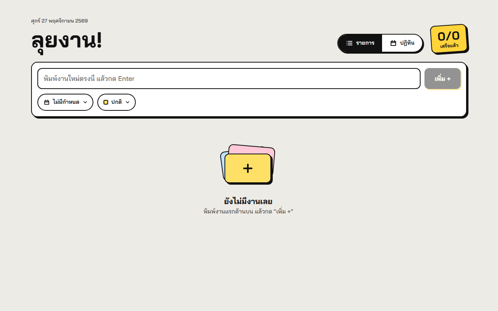

รายการงานบนจอใหญ่


รายการงานบนมือถือ

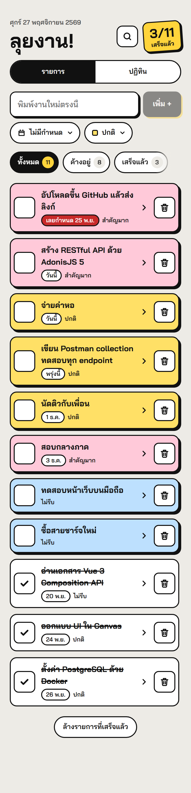

ตัวเลือกกำหนดส่งแบบกล่องลอยบนจอใหญ่ และแบบแผงเลื่อนขึ้นบนมือถือ


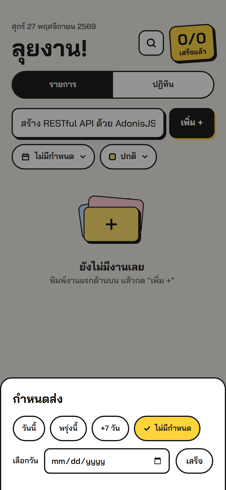

ลบงานแล้วมีแถบเลิกทำ และตอนกำลังโหลด

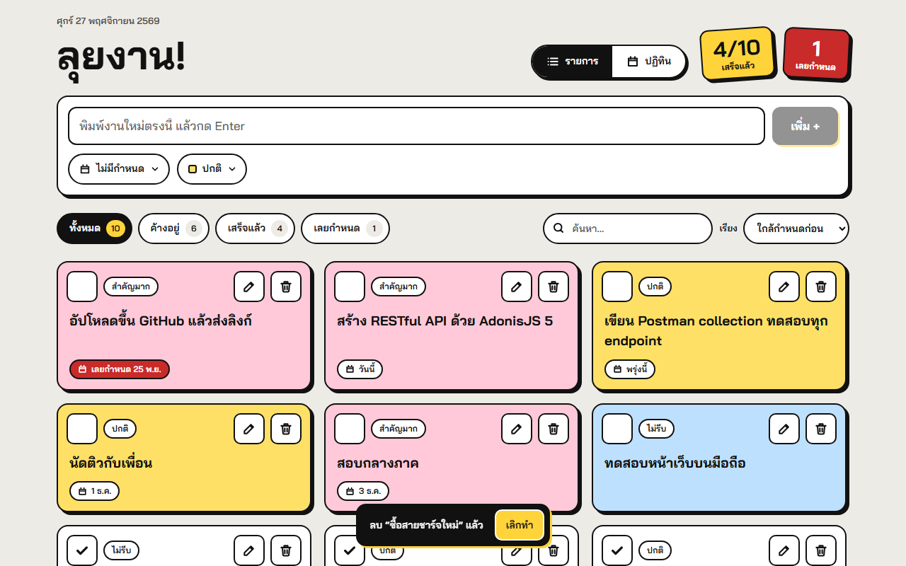

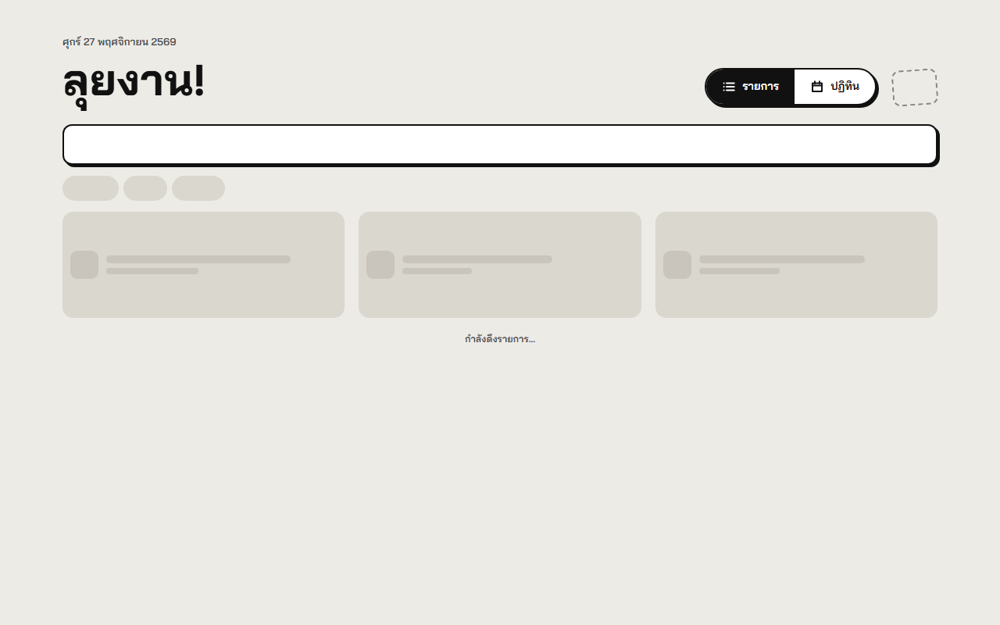

หน้ารายละเอียด ถามก่อนทิ้งการแก้ไข ข้อความใต้ช่องเมื่อข้อมูลไม่ผ่าน และบันทึกไม่สำเร็จบนมือถือ


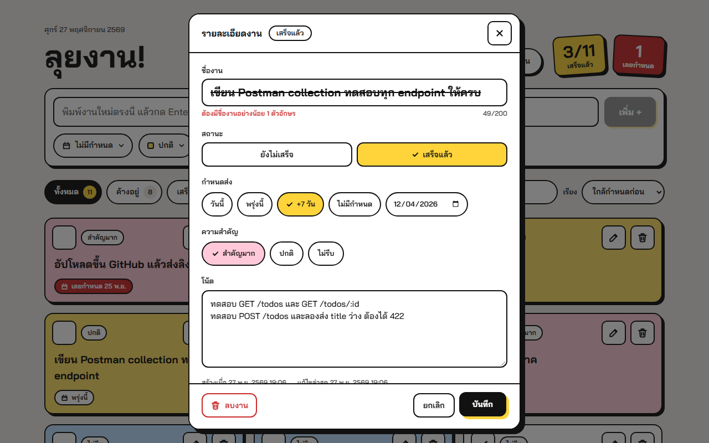

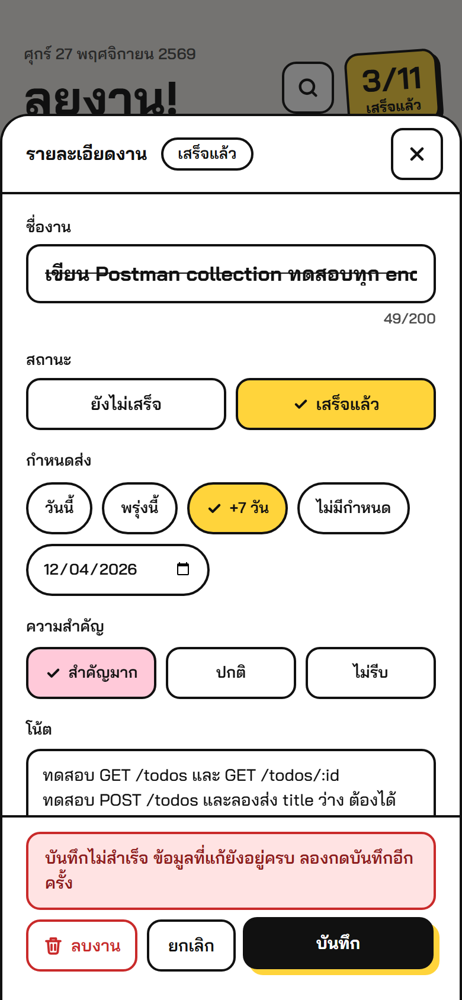

ปฏิทินรายเดือนบนจอใหญ่ และแถบสัปดาห์บนมือถือ


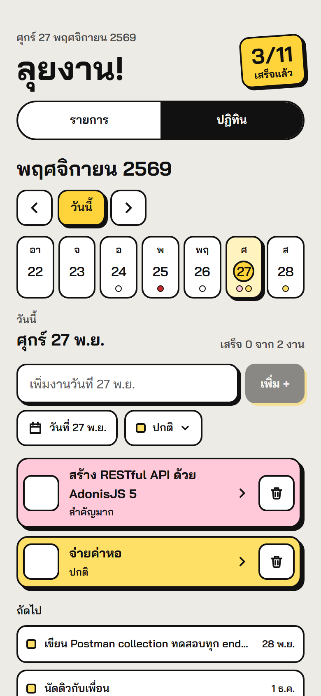

ส่งไม่สำเร็จแล้วย้อนกลับพร้อมแถบสีแดง และโหลดรายการไม่สำเร็จ

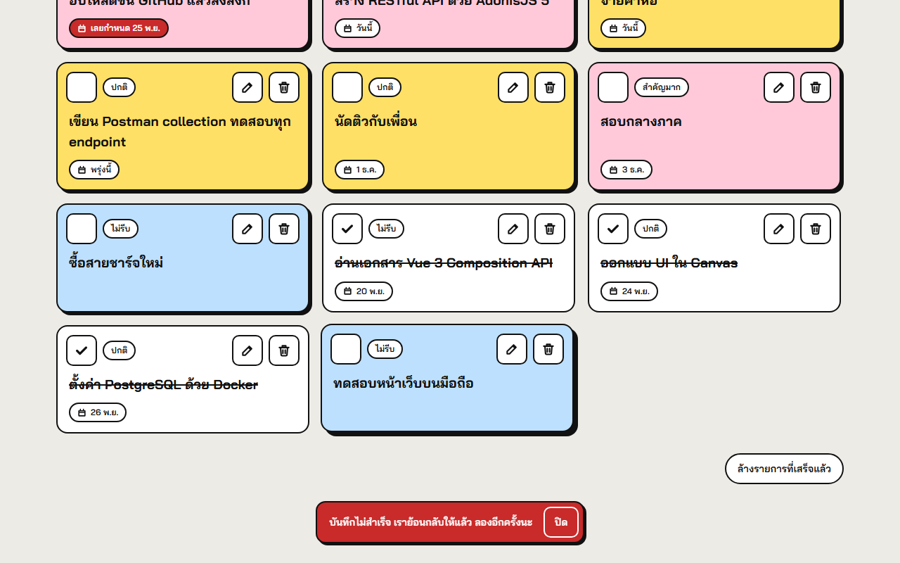


รีเฟรชหน้าแล้วข้อมูลยังอยู่ (ก่อนและหลังรีเฟรช)

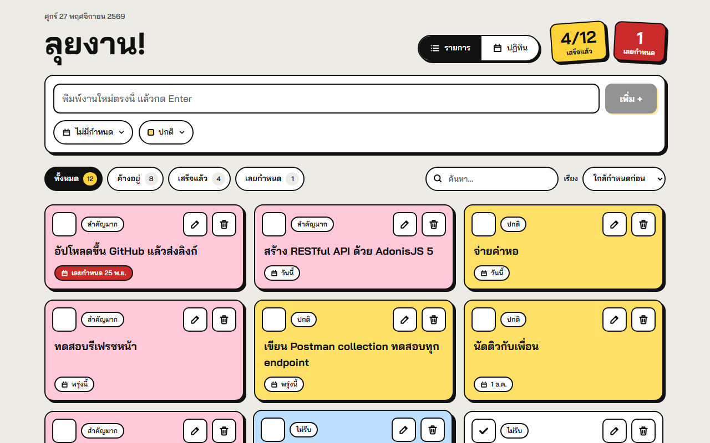


คำขอที่ส่งไปยัง API ในแต่ละการกระทำ และผลการ build


เว็บที่ deploy แล้ว ทดสอบเพิ่มงานผ่านหน้าเว็บจริงบนจอใหญ่ และหน้ารายการบนมือถือ

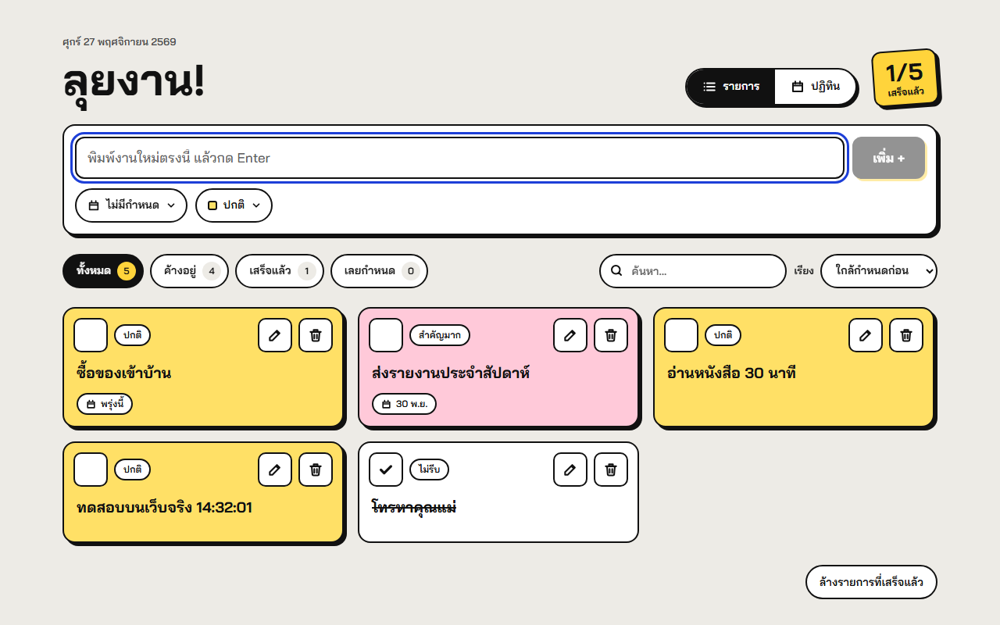

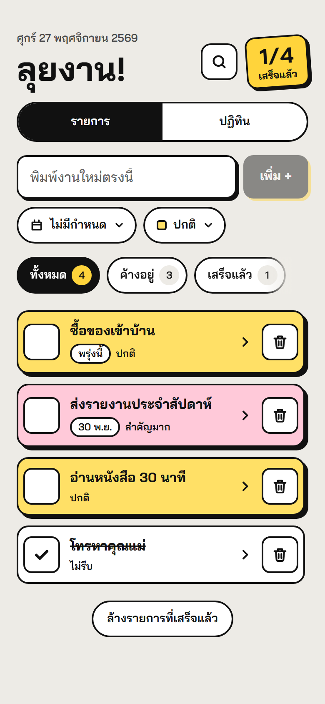

ตอนเซิร์ฟเวอร์กำลังตื่น (จำลองด้วยสคริปต์ `tools/shot/wake.mjs`)


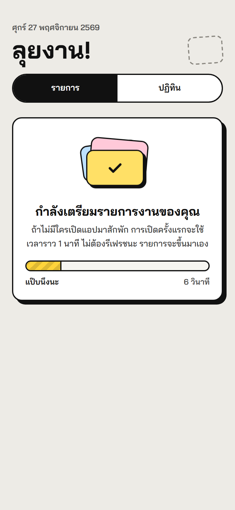
