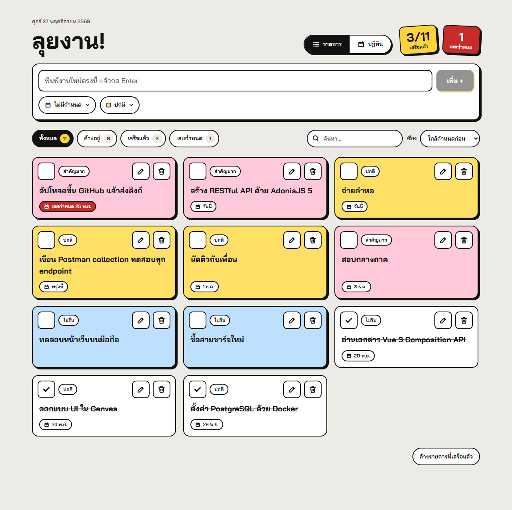
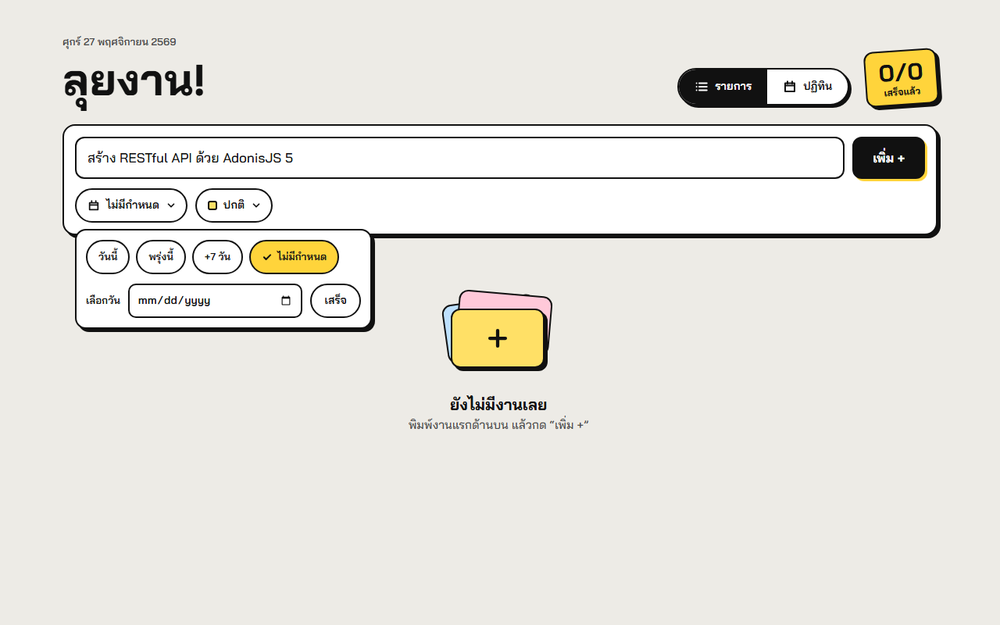
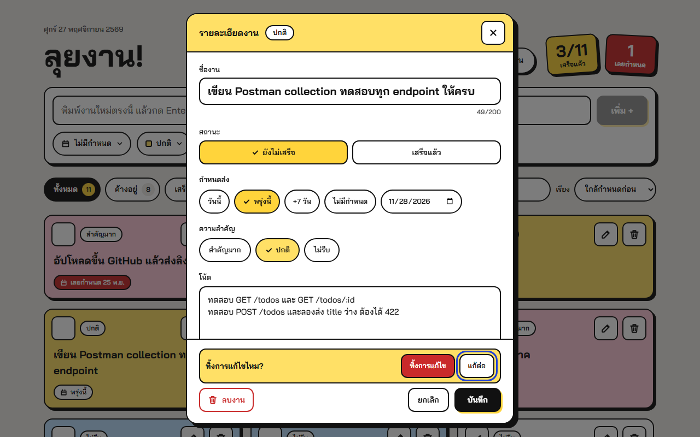
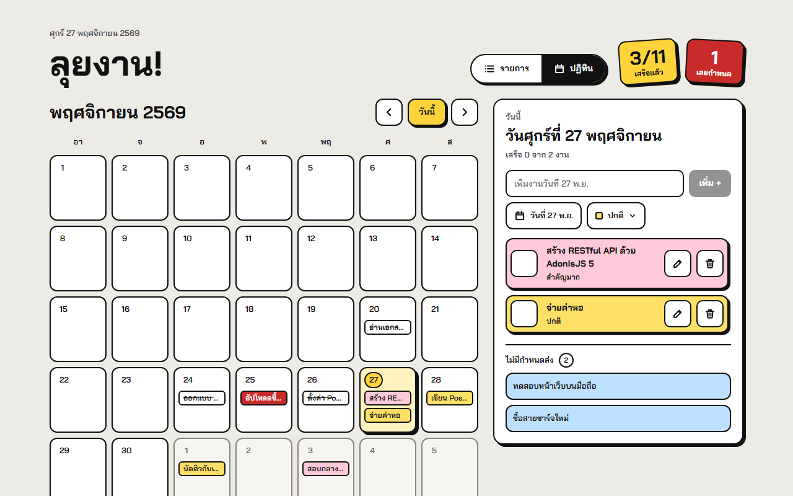
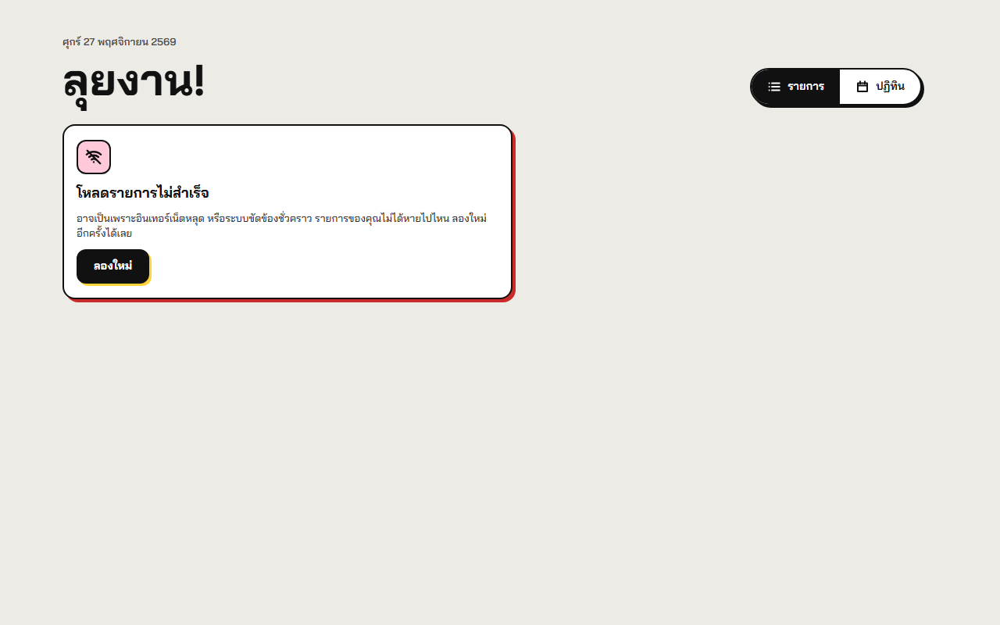
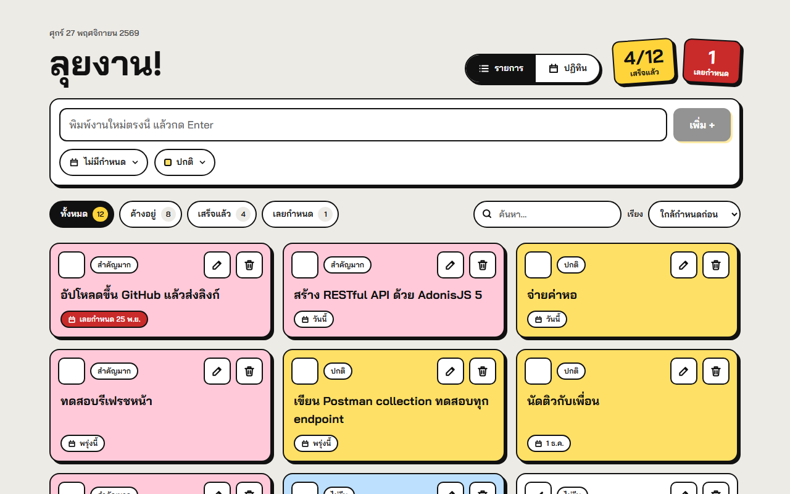
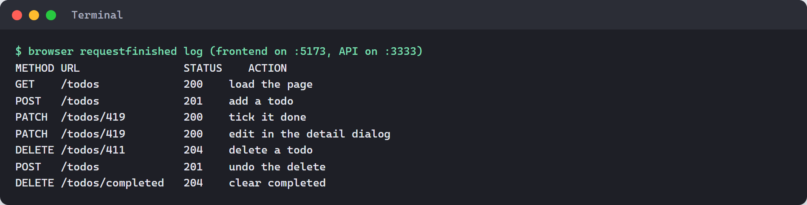
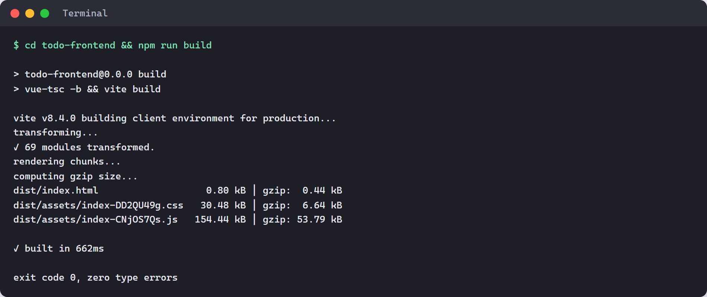
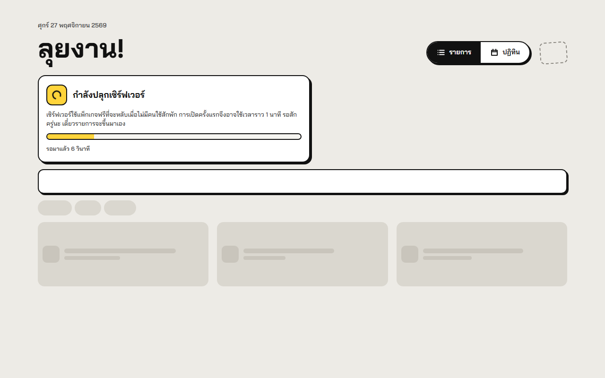

# Todo Frontend

หน้าเว็บของแอป Todo List ชื่อ "ลุยงาน!" ทำด้วย Vue.js 3 และ TypeScript ดีไซน์แบบ neo-brutalist ทุกการกระทำส่งคำขอไปที่ [todo-api](../todo-api) ทันที และรีเฟรชหน้าแล้วรายการยังอยู่ เพราะดึงจาก API ทุกครั้งที่เปิดหน้า

ลองใช้งานได้ที่ https://todo-frontend-xuka.onrender.com (API อยู่ที่ https://todo-api-g7v9.onrender.com) API ใช้แพ็กเกจฟรีของ Render ซึ่งจะหลับเมื่อไม่มีคนใช้ 15 นาที การเปิดครั้งแรกหลังจากนั้นจึงต้องรอราว 30 ถึง 40 วินาที (วัดจริงเมื่อ 28 พฤศจิกายน 2569 API ตอบที่ 32.6 วินาที และงานขึ้นที่ 37.3 วินาที)

แอปนี้ไม่มีระบบเข้าสู่ระบบ ตามโจทย์มีรายการงานเพียงชุดเดียว ทุกคนที่เปิดลิงก์จะเห็น แก้ และลบงานชุดเดียวกัน ไม่มีการแยกผู้ใช้ หน้าเว็บจึงมีกล่องแจ้งว่านี่คือรายการที่ใช้ร่วมกัน ขอไม่ให้พิมพ์ข้อมูลส่วนตัว และมีปุ่มคัดลอกลิงก์ไว้ส่งให้คนอื่น กด “เข้าใจแล้ว” แล้วกล่องจะไม่ขึ้นอีกในเบราว์เซอร์นั้น (จำไว้ใน localStorage ถ้าเบราว์เซอร์ไม่ให้เก็บ กล่องจะขึ้นใหม่ทุกครั้งที่เปิด แต่ยังเรียกกลับมาได้จากปุ่มใต้ส่วนหัว) และใต้ป้ายช่องโน้ตในหน้ารายละเอียดก็มีคำเตือนสั้นๆ เดียวกัน

## ฟีเจอร์

ส่วนหัวมีป้ายสองอัน ป้ายเหลือง “งานวันนี้” นับเฉพาะงานที่ครบกำหนดวันนี้ เช่น 1/3 เสร็จแล้ว และตัวเลขตรงกับแผงวันนี้ในปฏิทินเสมอ ส่วนป้ายแดง “เลยกำหนด” นับงานที่ยังไม่เสร็จและเลยวันกำหนดมาแล้ว กดป้ายแล้วพาไปที่กลุ่มนั้นในรายการ

การเพิ่มงานบนจอใหญ่ทำจากช่องพิมพ์ด้านบน บนมือถือกดปุ่มกลม + แล้วมีแผ่นเพิ่มงานเลื่อนขึ้นจากด้านล่าง กำหนดส่งเลือกได้จากปุ่มกดครั้งเดียว ไม่มีกำหนดส่ง วันนี้ พรุ่งนี้ อีก 7 วัน หรือเลือกวันอื่นจากปฏิทินภาษาไทยของแอปเอง ที่แสดงเป็นปีพุทธศักราช (ไม่ได้ใช้ช่องวันที่ของเบราว์เซอร์ ซึ่งบางเครื่องขึ้นเป็นภาษาอังกฤษและปีคริสต์ศักราช) ความสำคัญเลือกจากแผ่นตัวเลือก ถ้าเลือกวันที่ผ่านมาแล้วจะมีบรรทัดเตือนสีแดงหนึ่งบรรทัด เพิ่มงานแล้วมีแถบยืนยัน ถ้างานใหม่อยู่นอกจอจะมีปุ่ม "ดูงาน" พาไปที่การ์ด

รายการมีตัวกรอง ทั้งหมด ยังไม่เสร็จ เสร็จแล้ว เลยกำหนด พร้อมจำนวน ค้นหาจากชื่อและโน้ต (มีปุ่ม ล้างคำค้น ของแอปเองในช่อง) และเมนูเรียงของแอปเอง (ไม่ใช่ select ของเบราว์เซอร์) เรียงตามกำหนดส่ง ความสำคัญ หรือเพิ่มล่าสุด ทุกการเรียงมีหัวข้อกลุ่ม งานที่เสร็จแล้วอยู่กลุ่มท้ายสุดและเรียงจากเสร็จล่าสุดขึ้นก่อน การ์ดที่เสร็จแล้วมีชิป “เสร็จเมื่อ” บอกเวลาที่ติ๊ก (เก็บเป็น `completed_at` ใน API) การ์ดที่เลยกำหนดมีปุ่มย้ายมาวันนี้หรือไปพรุ่งนี้อยู่ในการ์ด บนจอใหญ่กลุ่มงานจัดเป็นหลายคอลัมน์แบบหนังสือพิมพ์โดยไม่ตัดกลุ่มข้ามคอลัมน์

ติ๊กว่าเสร็จแล้วมีแถบแจ้งพร้อมปุ่ม เลิกทำ แถบบอกด้วยว่างานย้ายไปอยู่กลุ่มไหน การลบมีแถบเลิกทำนาน 8 วินาที ลบหลายงานติดกันก็เลิกทำได้ทั้งหมดในครั้งเดียว และเลิกทำการลบแล้วงานกลับมาเหมือนเดิมทุกอย่าง ทั้งชื่อ โน้ต กำหนดส่ง ความสำคัญ เวลาที่สร้าง และเวลาที่เสร็จ (API รับ `created_at` กับ `completed_at` ตอนสร้างเพื่อเรื่องนี้) ปุ่มลบงานที่เสร็จแล้วอยู่ข้างหัวข้อ เสร็จแล้ว มีขั้นตอนยืนยันในบรรทัดเดียวกันและเลิกทำได้ การย้ายวันของงานที่เลยกำหนดก็เลิกทำได้ ปุ่มย้อนกลับของมือถือปิดหน้ารายละเอียดและแผงตัวเลือกแทนการออกจากแอป ถ้ามีงานที่แก้ค้างไว้จะถามก่อน

หน้ารายละเอียดเปิดเป็นป๊อปอัปบนจอใหญ่และแผงเลื่อนขึ้นบนมือถือ แก้ได้ทั้งชื่อ สถานะ กำหนดส่ง ความสำคัญ และโน้ต สถานะบันทึกทันทีที่เปลี่ยน ส่วนอื่นกด บันทึก ถ้ากดปิดตอนที่ยังไม่บันทึกจะถามว่าทิ้งการแก้ไขไหม การบันทึกส่งเฉพาะฟิลด์ที่เปลี่ยน ถ้าบันทึกไม่สำเร็จหน้าต่างจะไม่ปิดและค่าที่แก้ยังอยู่ครบ

มุมมองปฏิทินเป็นรายเดือนบนจอใหญ่ และเป็นแถบสัปดาห์บนมือถือ เลือกวันแล้วดูงานของวันนั้นและเพิ่มงานลงวันนั้นได้ทันที มีคำอธิบายจุดสี และถ้ามีงานเกินที่ช่องแสดงได้จะเขียน +N งาน

ทุกการกระทำอัปเดตหน้าจอก่อน (optimistic) แล้วย้อนกลับพร้อมแถบแจ้งเตือนสีแดงถ้าส่งไม่สำเร็จ ไอคอนหมุนจะขึ้นในปุ่มติ๊กเมื่อรอเกิน 300 มิลลิวินาที ตอนโหลดมี skeleton ถ้ารอเกิน 3 วินาทีจะเปลี่ยนเป็นการ์ด "กำลังเตรียมรายการงานของคุณ" ที่บอกด้วยภาษาธรรมดาว่าอาจรอราว 30 ถึง 40 วินาที พร้อมการ์ดสามใบที่ขยับเบาๆ แถบความคืบหน้า และจำนวนวินาทีที่รอ และจะลองเรียกใหม่เองจนเซิร์ฟเวอร์ตื่น (สูงสุด 2 นาที) เพราะ API อยู่บนแพ็กเกจฟรีที่หลับเมื่อไม่มีคนใช้ ถ้าโหลดไม่ได้จริงจะมีการ์ดพร้อมปุ่มลองใหม่ ถ้าเครื่องไม่ได้ต่ออินเทอร์เน็ตจะมีแถบแจ้งออฟไลน์ทันทีและโหลดเองเมื่อต่อได้ เพิ่มงานไม่สำเร็จข้อความที่พิมพ์ไว้จะกลับมาอยู่ในช่องเดิม และเมื่อกลับมาที่แท็บนี้ รายการจะดึงใหม่เพื่อให้เห็นสิ่งที่แก้จากแท็บหรือเครื่องอื่น รายการเก็บได้ไม่เกิน 200 งาน ถ้าเต็มจะมีข้อความบอกให้ลบงานที่เสร็จแล้วก่อน วันที่แสดงเป็นปีพุทธศักราชด้วย `Intl.DateTimeFormat('th-TH')` ส่วนการใช้งานด้วยคีย์บอร์ดรองรับทั้งหน้ารายการ ตัวเลือก ปฏิทินเลือกวัน เมนูเรียง หน้ารายละเอียด และปฏิทิน ปุ่มและจุดกดทุกจุดมีขนาดอย่างน้อย 44 พิกเซล ช่องพิมพ์บนมือถือใช้ตัวอักษร 16 พิกเซลขึ้นไป เพื่อไม่ให้ iPhone ซูมหน้าเองตอนแตะ โปรแกรมอ่านหน้าจอได้ยินทุกข้อความแจ้งเตือน หลังลบหรือเลิกทำ ตำแหน่งคีย์บอร์ดจะไปอยู่ในที่ที่ใช้งานต่อได้ ไม่หลุดไปบนสุดของหน้า

## Tech Stack

Vue.js 3 แบบ Composition API (`<script setup lang="ts">`) กับ TypeScript โหมด strict, Vite, Tailwind CSS v4 ผ่าน `@tailwindcss/vite` โดยกำหนดโทเคนสี เงา และฟอนต์ไว้ใน `@theme`, vue-router สองเส้นทางคือ `/` และ `/calendar` และฟอนต์ Bai Jamjuree จากแพ็กเกจ `@fontsource/bai-jamjuree` ซึ่ง Vite รวมไฟล์ฟอนต์ไว้ในโฟลเดอร์ `assets` ของเว็บเอง หน้าเว็บจึงไม่ต้องต่อไปที่ Google Fonts ก่อนวาดหน้าแรก ไม่ใช้ไลบรารี UI ทุกคอมโพเนนต์เขียนเอง ขนาดตัวอักษรทั้งหมดเขียนเป็นหน่วย rem จึงโตตามขนาดตัวอักษรที่ผู้ใช้ตั้งไว้ในเบราว์เซอร์

## การติดตั้งและรัน

ต้องเปิด todo-api ให้ทำงานก่อน (ดูวิธีในไฟล์ README ของ todo-api) แล้วจึงรันหน้าเว็บ

```bash
npm install
cp .env.example .env   # ตั้งค่า VITE_API_URL ให้ชี้ไปที่ API Server
npm run dev            # เปิดที่ http://localhost:5173
```

สร้างไฟล์สำหรับใช้งานจริงด้วย `npm run build` ซึ่งรัน `vue-tsc` ตรวจชนิดข้อมูลก่อนแล้วจึง build ด้วย Vite

## Environment Variables

`VITE_API_URL` คือ URL ของ RESTful API Server ค่าตัวอย่างคือ `http://localhost:3333` และ API อนุญาต CORS ให้ origin `http://localhost:5173`

## Deploy

หน้าเว็บอยู่บน Render แบบ Static Site คำสั่ง build คือ `npm ci && npm run build` โฟลเดอร์ที่เผยแพร่คือ `dist` และตั้ง `VITE_API_URL=https://todo-api-g7v9.onrender.com` ไว้ตอน build เพราะ router ใช้ history mode จึงตั้งกฎ rewrite ให้ทุก path (`/*`) ส่ง `/index.html` เพื่อให้เปิด `/calendar` ตรงๆ หรือรีเฟรชหน้านั้นได้ ไฟล์ที่มีอยู่จริงใน `dist` เช่น `manifest.webmanifest` `favicon.ico` `robots.txt` และ `og-image.png` ถูกส่งตามจริงก่อนกฎ rewrite

## การแชร์ลิงก์ ไอคอน และการค้นหา

ใน `index.html` มีคำอธิบายหน้า แท็ก Open Graph และ Twitter card ที่ชี้ไปที่ `https://todo-frontend-xuka.onrender.com` ส่งลิงก์ใน LINE หรือ Facebook แล้วจะขึ้นชื่อ คำอธิบาย และรูปตัวอย่างลิงก์ `og-image.png` ขนาด 1200 x 630 พิกเซล (ลิงก์รูปมี `?v=3` ต่อท้ายเพื่อให้แอปแชตดึงรูปใหม่แทนรูปที่จำไว้) ไอคอนสำหรับเพิ่มลงหน้าจอโฮมอยู่ใน `public` (`icon-192.png` `icon-512.png` `icon-maskable-512.png` `apple-touch-icon.png` และ `favicon.ico`) และประกาศไว้ใน `manifest.webmanifest` รูปทั้งหมดสร้างจากไฟล์ HTML ในโฟลเดอร์ `brand` ถ้าแก้หน้าตาให้รัน `node brand/render.mjs` (ใช้ Playwright จาก `tools/shot` ของโปรเจกต์หลัก) แล้วไฟล์ใน `public` จะถูกสร้างใหม่

หน้าเว็บตั้งใจไม่ให้เครื่องมือค้นหาเก็บ โดยใส่ `<meta name="robots" content="noindex" />` ไว้ใน `index.html` เหตุผลคือรายการนี้เป็นรายการสาธารณะที่ทุกคนที่มีลิงก์แก้ได้ ถ้า Google เก็บไป ข้อความที่ใครก็ไม่รู้พิมพ์ไว้ในวันที่บอตมาอาจไปโผล่ในผลค้นหา ซึ่งอาจเป็นข้อมูลส่วนตัว และคนที่ค้นเจอก็จะเข้ามาเขียนเล่นในรายการเดียวกับที่ผู้ตรวจใช้ งานนี้ส่งให้กันด้วยลิงก์อยู่แล้ว การถูกค้นเจอจึงไม่ได้ช่วยอะไร ส่วน `robots.txt` ยังเขียนว่า `Allow: /` ไม่ได้ปิดด้วย `Disallow` เพราะบอตต้องเข้ามาอ่านหน้าได้จึงจะเห็นคำสั่ง noindex และตัวดึงตัวอย่างลิงก์ของ LINE กับ Facebook ก็ยังอ่านแท็กแชร์ได้ตามปกติ ผลข้างเคียงคือ Lighthouse จะหักคะแนนหมวด SEO ข้อ `is-crawlable` ซึ่งเป็นสิ่งที่ตั้งใจไว้ ถ้าวันหนึ่งอยากให้ค้นเจอ ให้ลบบรรทัด noindex แล้วใส่ `<link rel="canonical" href="https://todo-frontend-xuka.onrender.com/" />` แทน

แอปเป็นสีสว่างอย่างเดียว `index.html` และ `style.css` จึงประกาศ `color-scheme: only light` เพื่อไม่ให้เบราว์เซอร์ที่มีโหมดมืดอัตโนมัติ เช่น Samsung Internet หรือ Chrome บน Android กลับสีหน้าเว็บเอง

## โครงสร้างโปรเจกต์

```
src/
  main.ts, router.ts, style.css   จุดเริ่มต้น เส้นทาง และโทเคนธีม Tailwind
  App.vue                         โครงหน้า หัวหน้า กล่องแจ้งรายการที่ใช้ร่วมกัน หน้ารายละเอียด และแถบแจ้งเตือน
  types.ts                        ชนิดข้อมูล Todo และค่าคงที่ของความสำคัญ
  api/todos.ts                    fetch wrapper ของทุก endpoint และ ApiError
  utils/date.ts                   วันที่แบบ YYYY-MM-DD และการแสดงผลภาษาไทย
  composables/
    useTodos.ts                   state กลาง optimistic update ย้อนกลับ เลิกทำ และแถบแจ้งเตือน
    useListUi.ts                  ตัวกรอง ค้นหา เรียง และการจัดกลุ่ม
    useCalendarTodos.ts           จัดงานตามวันสำหรับปฏิทิน
    useDetail.ts, useFocus.ts, useMedia.ts
  components/                     การ์ด แถบเพิ่มงานและแผ่นเพิ่มงานบนมือถือ ปุ่มวันที่ ThaiDatePicker
                                  SortMenu ตัวเลือก หน้ารายละเอียด WakeCard ConnectionBanner SharedNotice และอื่น ๆ
  views/ListView.vue, CalendarView.vue
brand/                            ไฟล์ HTML ต้นฉบับของรูปแชร์ลิงก์และไอคอน และสคริปต์ render.mjs
public/                           favicon, ไอคอน, manifest.webmanifest, robots.txt และ og-image.png
```

## การทดสอบและการตรวจคุณภาพ

เราตรวจงานเป็นสี่รอบ แต่ละรอบมีผู้รีวิวที่ลองใช้แบบผู้ใช้จริงหลายบทบาท (เช่น คนที่ใช้มือถือเครื่องเล็ก คนที่เปิดครั้งแรก และคนที่ต้องการค้นหา) แล้วถามว่าตัวเลขและป้ายแต่ละอันสื่อความหมายอะไรกับผู้ใช้ เทียบกับสิ่งที่มันทำจริง ข้อที่เจอถูกแก้ แล้วเขียนสคริปต์ Playwright คอยตรวจซ้ำ สคริปต์อยู่ในโฟลเดอร์ `docs/qa` ของโปรเจกต์หลัก

| สคริปต์ | จำนวนข้อตรวจที่ผ่าน |
|---|---|
| `docs/qa/scripts/verify-fixes.mjs` (รอบแรก) | 10 |
| `docs/qa/round2/scripts` | 52 |
| `docs/qa/round3/scripts` | 150 |
| `docs/qa/round4/scripts/verify-round4.mjs` | 398 |

ส่วนการทดสอบ API ด้วย Postman และ newman (32 คำขอ 71 รายการตรวจ) อยู่ใน README ของ todo-api

## ภาพหน้าจอ

ภาพทั้งหมดถ่ายจากแอปจริงที่ต่อกับ API จริงด้วยสคริปต์ `tools/shot/flows.mjs` ของโปรเจกต์หลัก ชุดเต็มอยู่ที่ `docs/screenshots/frontend/` ของโปรเจกต์

หน้าแรกตอนยังไม่มีงาน


รายการงานบนจอใหญ่



รายการงานบนมือถือ


ตัวเลือกกำหนดส่งแบบกล่องลอยบนจอใหญ่ และแบบแผงเลื่อนขึ้นบนมือถือ




ลบงานแล้วมีแถบเลิกทำ และตอนกำลังโหลด


หน้ารายละเอียด ถามก่อนทิ้งการแก้ไข ข้อความใต้ช่องเมื่อข้อมูลไม่ผ่าน และบันทึกไม่สำเร็จบนมือถือ




ปฏิทินรายเดือนบนจอใหญ่ และแถบสัปดาห์บนมือถือ




ส่งไม่สำเร็จแล้วย้อนกลับพร้อมแถบสีแดง และโหลดรายการไม่สำเร็จ




รีเฟรชหน้าแล้วข้อมูลยังอยู่ (ก่อนและหลังรีเฟรช)




คำขอที่ส่งไปยัง API ในแต่ละการกระทำ และผลการ build





เว็บที่ deploy แล้ว ทดสอบเพิ่มงานผ่านหน้าเว็บจริงบนจอใหญ่ และหน้ารายการบนมือถือ


ตอนเซิร์ฟเวอร์กำลังตื่น (จำลองด้วยสคริปต์ `tools/shot/wake.mjs`)




